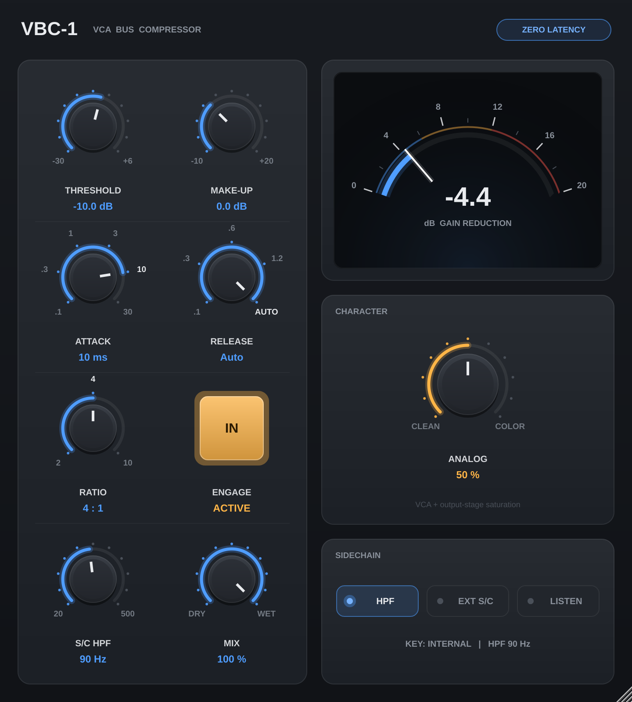
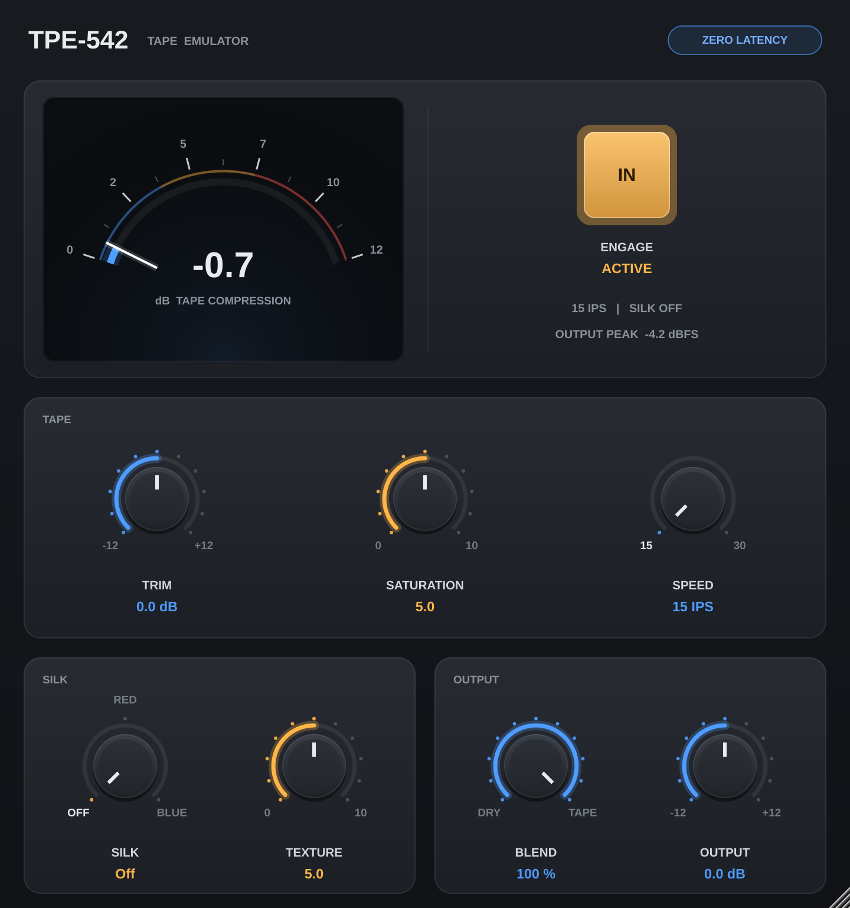

# Audio Plugins

A small family of audio plugins (VST3 + AU, and AAX for Pro Tools when the Avid SDK is
available), built with JUCE 8 for Apple-silicon Macs and designed for live use in hosts such as
**Live Professor**. Every plugin shares one real-time-safe toolkit, one design system and one
build/test/validation pipeline.

| Plugin | What it is | Latency |
|---|---|---|
| [VBC-1 Bus Compressor](plugins/VBC1/README.md) | Stereo VCA bus compressor with S/C HPF, analog colour, parallel mix | 0 samples |
| [TPE-542 Tape Emulator](plugins/TPE542/README.md) | 500-series-style tape emulator: saturation, 15/30 IPS, Silk Red/Blue, blend | 0 samples |

 

## Getting the plugins
**Download (no tools needed):** every push builds all plugins on an Apple-silicon GitHub runner,
runs the tests, validates each VST3 with `pluginval` and each AU with Apple's `auval`, and
uploads **`AudioPlugins-macOS`**. On GitHub (signed in): **Actions → latest run → Artifacts**.
Unzip it and run:

```bash
bash install_mac.sh            # all plugins
bash install_mac.sh VBC-1      # just one
```
Then rescan plug-ins in your host. (GitHub Actions is free for this public repo, including macOS.)

**Build locally** (Apple command-line tools + `brew install cmake`; the Xcode app is optional):
```bash
cmake -B build -DCMAKE_BUILD_TYPE=Release
cmake --build build -j 8
ctest --test-dir build
bash scripts/install_mac.sh
```

### Pro Tools (AAX)
AAX is built automatically when the Avid AAX SDK is available:
`cmake -B build -DKIT_AAX_SDK_PATH=/path/to/AAX_SDK` (or set `AAX_SDK_PATH`; in CI, set a
repository secret `AAX_SDK_URL` pointing at a private download of the SDK zip). The SDK is free
from Avid's developer portal but may not be committed to this repo. Unsigned AAX builds load only
in the Pro Tools *Developer* build; retail Pro Tools requires PACE signing. Details:
[`.claude/skills/audio-plugin/SKILL.md`](.claude/skills/audio-plugin/SKILL.md#pro-tools-aax).

## Making a new plugin
```bash
python3 scripts/new_plugin.py --target OPT1 --name "OPT-1 Opto Leveler" --code Opt1 \
    --short "OPT-1" --subtitle "optical leveling amplifier" --latency 0 \
    --vst3-categories "Fx Dynamics" --aax-category AAX_ePlugInCategory_Dynamics
```
This creates `plugins/OPT1/`: a working, tested effect (gain / mix / crossfaded bypass) on the
shared kit, which CMake and CI pick up automatically. Then replace the DSP, parameters and layout.
When working with Claude Code, just describe the plugin — the **`audio-plugin` skill** in
`.claude/skills/` walks through the whole process (it starts by asking whether the plugin must be
zero-latency).

## Repository layout
```
CMakeLists.txt              top level: JUCE, kit, every plugins/*/
cmake/KitPlugin.cmake       kit_add_plugin(): formats, identity, tests, tools for each plugin
common/kit/dsp/             framework-free DSP blocks (smoother, SVF, DC blocker, fixed delay…)
common/kit/ui/              theme, look-and-feel, ParamBinding, KnobCell, GR meter, editor base
common/kit/tests/           generic real-time-safety test (traps malloc/new/free/locks)
common/kit/tools/           headless editor screenshot tool
plugins/<NAME>/             one folder per plugin (Source/, tests/, README.md, docs/)
templates/plugin/           template used by scripts/new_plugin.py
scripts/                    new_plugin.py, install_mac.sh
.github/workflows/          Linux RT-safety job + macOS build/validate/package job
.claude/skills/audio-plugin the Claude Code skill for building plugins here
```

Per plugin, CMake creates: `<NAME>_VST3` / `_AU` / `_AAX`, `<NAME>_dsp_tests`, and on Linux
`<NAME>_rt_safety_test` and `<NAME>_screenshot` (renders the editor to a PNG).

JUCE is used under its GPLv3/commercial licence terms — distribute accordingly.
