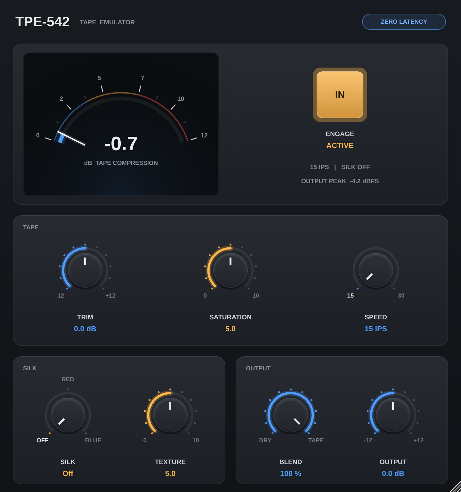

# TPE-542 Tape Emulator

A zero-latency stereo tape emulator (AU, AAX for Pro Tools, and VST3) modelled on the behaviour of a
500-series transformer-coupled tape-emulation module: drive into a magnetic-saturation curve,
15 / 30 IPS tape-speed EQ, output-stage "silk" harmonic colour, and a parallel blend.
Built with JUCE 8; universal arm64 + x86_64 binary, macOS 11+.

## Controls

| Control | Range | Notes |
|---|---|---|
| Trim | -12 … +12 dB | level into the tape; also drives the saturation |
| Saturation | 0 … 10 | drive into an asymmetric soft-saturation curve (2nd + 3rd harmonics, tape compression). Level-compensated: unity gain for quiet signals. **0 = exactly linear** |
| Speed | 15 / 30 IPS | 15 IPS: +2.5 dB head bump around 50 Hz, softer top (-2 dB shelf at 10 kHz), more HF saturation. 30 IPS: tighter bump around 90 Hz, extended top |
| Silk | Off / Red / Blue | output-stage colour. Red: harmonics + slight lift in the upper mids/highs (above ~2 kHz). Blue: harmonics + weight in the lows (below ~220 Hz) |
| Texture | 0 … 10 | amount of Silk colour |
| Blend | 0 … 100 % | parallel mix of the trimmed (pre-tape) signal with the tape signal, sample-aligned |
| Output | -12 … +12 dB | output level |
| IN | on / off | crossfaded bypass (host bypass maps to it) |

The meter shows **tape compression**: how many dB the saturation curve is shaving off the peaks.

Tape behaviours modelled:
- Record pre-emphasis / playback de-emphasis around the nonlinearity, so highs saturate before
  lows (more so at 15 IPS), as on real tape
- Asymmetric saturation curve → even + odd harmonics; DC from the asymmetry is removed
- Head bump with the dip above it, subsonic low cut, speed-dependent HF response
- Only the distortion *difference* goes through de-emphasis and DC blocking, so the linear part of
  the tape path is never smeared

## Zero latency
No look-ahead, no oversampling — the plug-in reports **0 samples** (verified by the tests: an impulse
comes out at sample 0). Without oversampling, the saturation uses a smooth low-order curve and a
limited drive range (max ≈ -23 dBc 3rd harmonic on a -6 dBFS tone) to keep aliasing low.

## Real-time safety
Same guarantees as the rest of the repo: `processBlock()` never allocates, locks or does I/O; both
speed paths and both Silk bands always run, so CPU is constant and Speed / Silk / Blend / Bypass
changes are crossfaded (30 ms / 10 ms) and click-free. `TPE542_rt_safety_test` passes with
0 allocations and 0 locks in `processBlock` for mono and stereo, editor closed and open.

## Tests (`tests/dsp_tests.cpp`)
Latency = 0; Blend 0 % and Bypass bit-exact dry; bypass/speed/silk switching click-free;
Saturation 0 exactly linear; harmonics rise with Saturation; 2nd harmonic present; small-signal
unity gain and compression of loud signals; HF saturates before LF; head-bump and HF response for
both speeds; Red colours highs / Blue colours lows; Texture scales Silk; no DC; mono works.

## Identity
| | |
|---|---|
| Plugin code | `Tp42` |
| Manufacturer code | `Vbca` |
| Bundle id | `com.vbcaudio.tpe542` |
| Parameter ids | `trim`, `saturation`, `speed`, `silk`, `texture`, `blend`, `output`, `bypass` |
| VST3 category | Fx Distortion · AAX category Harmonic |

## Pro Tools (AAX)
CI builds the `.aaxplugin` when the repository secret `AAX_SDK_URL` points at a private download of
the Avid AAX SDK zip (free from Avid's developer portal; it can't be committed here). Unsigned AAX
builds load only in the Pro Tools *Developer* build; retail Pro Tools needs the plug-in signed with
PACE's tools (PACE developer account + iLok).

TPE-542 is an independent design; it is not affiliated with or endorsed by any hardware manufacturer.
